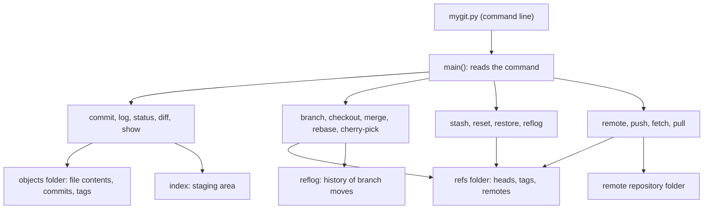

# mygit: a Git-style version control system in Python

mygit is a small version control tool written in pure Python, with no outside libraries. It saves snapshots of files, branches, tags, merges, and remotes in a hidden `.mygit` folder, using the same core ideas as Git.

## Features

- Commits, log, status, and diff (unified diff output)
- Branches, checkout, fast-forward merge, and three-way merge with conflict markers
- Conflict tools: `conflicts`, `resolve --ours`, `--theirs`, `--mark`
- Stash, cherry-pick, rebase, reset, and restore
- Reflog and tags (lightweight and annotated)
- Integrity check (`fsck`) and garbage collection (`gc`)
- Local remotes: `remote`, `push`, `fetch`, and `pull`, which refuse pushes that would overwrite remote work

## Architecture



## Quick start

Tested on Windows with Python 3.14.

```
python mygit.py init
python mygit.py config user.name "Your Name"
python mygit.py add hello.txt
python mygit.py commit -m "first commit"
python mygit.py log
```

## Testing

```
python -m unittest test_mygit -v
```

There are 7 automated tests. Each one works in its own temporary folder, so your real projects are never touched.

## Error handling

Commands refuse unsafe actions, explain why, and leave your files unchanged. Examples: a hard reset without `--yes`, a merge with unsaved changes, a push that would overwrite remote commits, and an unknown commit or branch name.

## Demo

Run `demo.ps1` in PowerShell to see a short tour of the main features.

## Project files

- `mygit.py`: the program
- `test_mygit.py`: automated tests
- `demo.ps1`: terminal demo

## Limitations

- Not compatible with GitHub or real Git repositories
- Remotes are folders on the same computer, not network servers
- No interactive rebase, no compression, and each object is stored as its own file